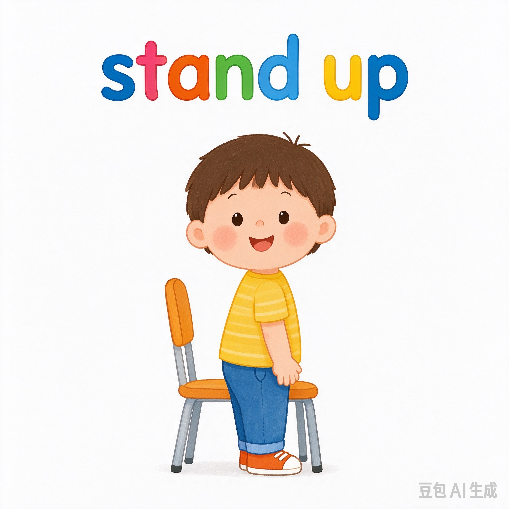
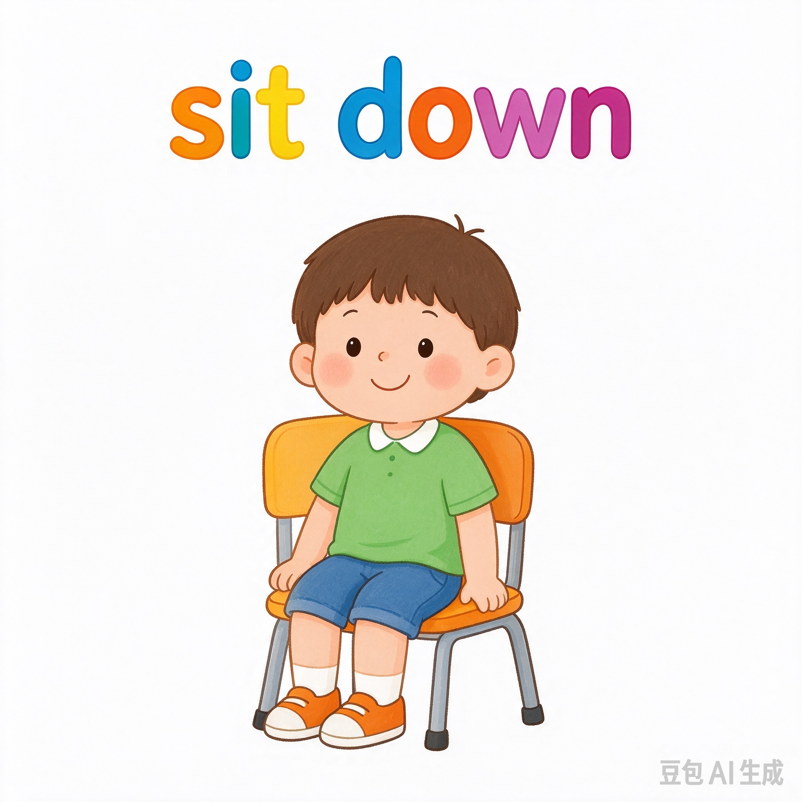
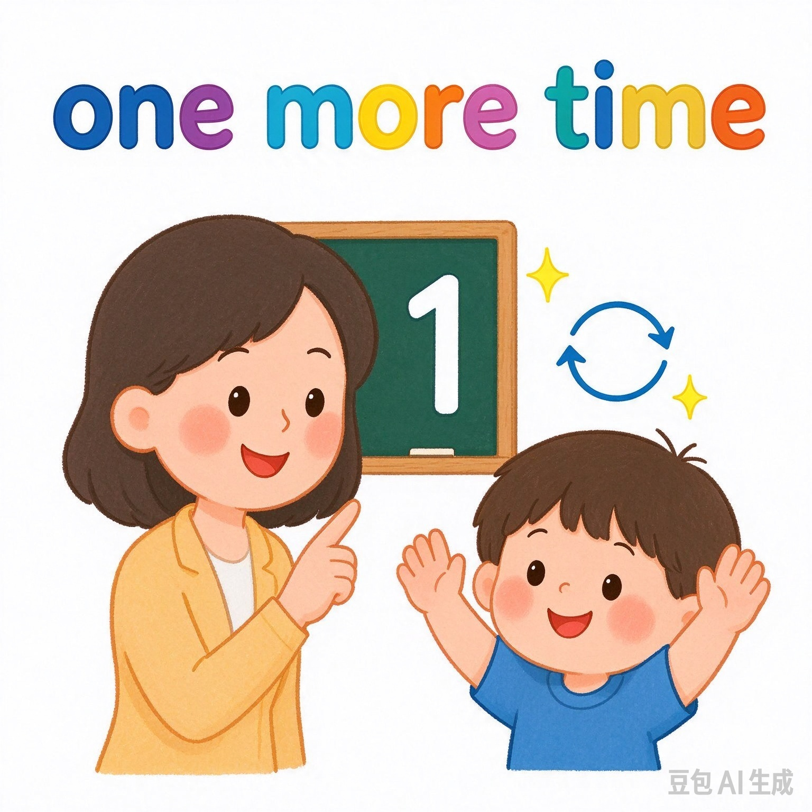

## Dialogue
1. What's your name?
    - My name is Fernando.
2. How old are you?
    - I am 18 years old.
3. How are you?
    - I am fine.
4. Can you say "stand up"?
    - Yes, I can say "stand up".
5. Can you say "sit down"?
    - Yes, I can say "sit down".
## Short Phrases
* stand up
  
* sit down
  
* one more time
  